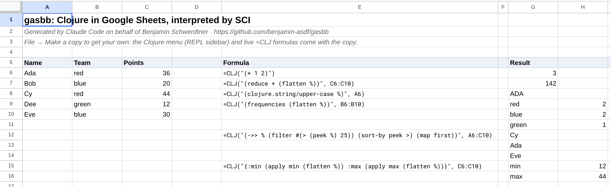
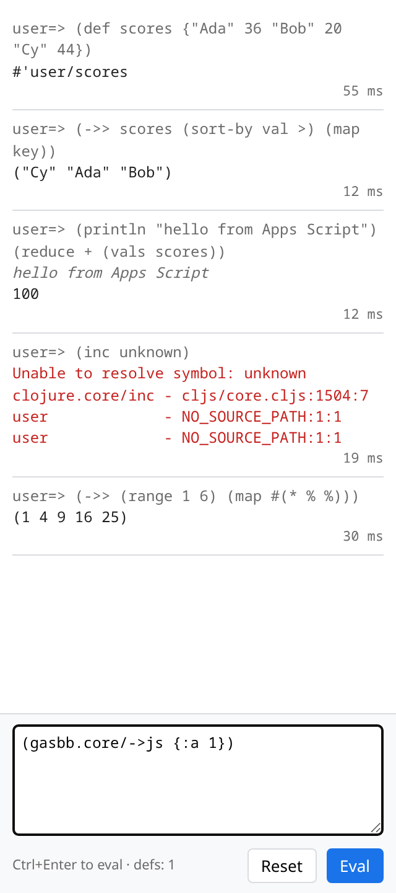

# gasbb

*Generated by Claude Code on behalf of Benjamin Schwerdtner.*

Clojure for [Google Apps Script](https://developers.google.com/apps-script), interpreted by
[SCI](https://github.com/babashka/sci). In the spirit of
[nbb](https://github.com/babashka/nbb) and [scittle](https://github.com/babashka/scittle):
no build step for your code. You write `.clj` files in the Apps Script project, and gasbb
evaluates them inside Apps Script's V8 runtime, with interop to `SpreadsheetApp`,
`DriveApp`, `GmailApp` and the rest (each service's OAuth scope goes in the manifest, see
[Scopes](doc/setup.md#scopes)).

```clojure
(ns main
  (:require [gasbb.sheets :as sheets]))

(defn top-scorers []
  (->> (sheets/read-maps "Scores")        ;; header row -> keyword keys
       (filter #(> (:points %) 30))
       (sort-by :points >)
       (map :name)))
```

And Clojure straight in a cell:

```
=CLJ("(->> % (map first) frequencies)", B2:B100)
```

Ranges arrive as vectors of rows. Sequences spill into a range, maps spill as key/value
rows, and a sequence of maps spills as a table with a header row. Try it: the [demo spreadsheet](https://docs.google.com/spreadsheets/d/1CXI2q7DkxalQYklY1nv3d8c9VCCzEUOvAMuobF729s4/edit)
is public, and *File → Make a copy* gives you your own, with the script included.





The REPL sidebar. Every eval is a fresh Apps Script execution, so the sidebar keeps the
top-level `ns`/`require`/`def…` forms and replays them before each eval. (Screenshot
rendered locally with the same bundle and a stubbed `google.script.run`, so the times shown
are browser times. In a sheet, each eval is a full server round trip.)
<br clear="right">

## What you get

- **`=CLJ(code, args...)`**: a custom spreadsheet function. Inside `code`, `%` / `%1` … `%9`
  are the arguments.
- **`.clj` files in the project**, loaded at runtime. `require` resolves other project files
  (`util.text` → `util/text.clj`). Each file is loaded at most once per execution.
- **Triggers and menu items in Clojure**: a few lines of `.gs` declare the entry points that
  Apps Script needs, and each one forwards to a Clojure function.
- **A REPL sidebar** in Google Sheets.
- **`gasbb.sheets`**: small helpers that turn sheets into Clojure data (`read-maps`,
  `write-rows!`, `append-row!`, …).
- **`println`** goes to the Apps Script execution log.

## Quick start

The full [setup guide](doc/setup.md) also covers copying the demo, clasp, standalone
scripts, web apps and troubleshooting.


1. Open a spreadsheet → *Extensions → Apps Script*.
2. Add a script file `gasbb` and paste [`dist/gasbb.js`](dist/gasbb.js) into it (~950 KB).
3. Copy the files from [`template/`](template):
   - `Code.js` → script file `Code`
   - `gasbb-repl.html` → HTML file `gasbb-repl`
   - `main.clj` → HTML file named `main.clj`
   - `appsscript.json` → manifest. To edit it, enable *Project Settings → Show
     "appsscript.json"*.
4. Reload the spreadsheet. A **Clojure** menu appears with *Open REPL*. `=CLJ("(+ 1 2)")`
   works in any cell.

Clojure files are stored as HTML files because that is the only file type besides scripts
that Apps Script keeps verbatim and lets you read at runtime
(`HtmlService.createHtmlOutputFromFile("main.clj").getContent()`). With
[clasp](https://github.com/google/clasp), name them `main.clj.html` locally.

## Entry points

Apps Script only sees functions that are declared in `.gs`/`.js` files. Declare the ones you
need and forward them:

```js
function onOpen(e)      { gasbb.run("main.clj", "main/on-open", e); }
function onEdit(e)      { gasbb.run("main.clj", "main/on-edit", e); }
function doGet(e)       { return gasbb.run("main.clj", "main/do-get", e); }
function dailyReport()  { gasbb.run("main.clj", "main/daily-report!"); }   // time trigger
function CLJ(code, ...args) { return gasbb.cell(code, args); }
```

```clojure
(defn on-open [_e]
  (-> (.getUi js/SpreadsheetApp)
      (.createMenu "Clojure")
      (.addItem "Open REPL" "gasbbOpenRepl")
      (.addToUi)))

(defn do-get [e]
  (.createTextOutput js/ContentService (str "hello " (.. e -parameter -name))))
```

## JS API (`globalThis.gasbb`)

| | |
|---|---|
| `gasbb.run(file, fnName, ...args)` | load `file` (once per execution), call `fnName` (`"ns/fn"`), return the result as plain JS |
| `gasbb.cell(code, args)` | backs `=CLJ`; converts ranges in and spills results out |
| `gasbb.evalString(code)` | evaluate a string, result as plain JS |
| `gasbb.loadFile(file)` | load a project file |
| `gasbb.replEval(history, code)` | REPL support, returns `{value, out, error, ns, keep}`; `keep` = the def-like forms of `code` to add to `history` |
| `gasbb.setFileReader(fn)` | replace how project files are read (see *As a library*) |

## Clojure API

- `gasbb.core`: `->js`, `->clj`, `version`
- `gasbb.sheets`: `active`, `sheet`, `values`, `rows->maps`, `maps->rows`, `read-maps`,
  `write-rows!`, `append-row!`
- `js/...` reaches every Apps Script global: `js/SpreadsheetApp`, `js/UrlFetchApp`,
  `js/Utilities`, …
- The SCI namespaces `clojure.string`, `clojure.set`, `clojure.walk` and `clojure.edn`

## How it runs

Every Apps Script execution (a trigger, a menu click, a cell recalculation, a REPL eval)
starts fresh: all script files are evaluated again, and nothing from earlier executions is
left (the self test checks this). gasbb does nothing until it is
first used, then creates the SCI context and loads the `.clj` files you ask for. These
numbers come from the self test running in Apps Script (`scripts/gas.py test`). They don't
include starting the execution, parsing the ~950 KB bundle, or the round trip from the
browser:

| | |
|---|---|
| first eval incl. SCI context init | ~8 ms |
| load a `.clj` file + one required ns | ~20 ms |
| `=CLJ("(* %1 %2)", …)` | ~9 ms |

The REPL sidebar keeps the top-level `ns`/`require`/`def…` forms of each eval in the
browser and replays them, in order and with the namespace carried over, before each new
eval, because the server forgets everything between calls. A `def` whose value has a side
effect runs that side effect again on every eval: `(def r (sheets/append-row! "Log" [1]))`
appends a row each time. Keep side effects in plain forms, not in `def`s. Only top-level
forms are kept (`(do (def a 1))` is not), and the forms that ran before an error are kept.
*Reset* forgets the kept forms.

## Limitations

- SCI is not the full Clojure: no `deftype` that Apps Script could see as a class.
- Speed is rarely the issue. Measured inside Apps Script, going over 100k cell values (a
  1000×100 `getValues` array) takes 3–40 ms in SCI, depending on the idiom (`reduce` over
  the JS arrays is fastest, `js->clj` first is slowest), against ~1 ms for a plain JS loop.
  The expensive part is the spreadsheet calls themselves: read and write with
  `getValues`/`setValues` in bulk, not one `getRange` per cell, as you would from JS anyway.
  (`scripts/gas.py push --test && scripts/gas.py bench` reproduces the numbers in Apps Script,
  `npm run bench` the same cases in Node.)
- There is no `setTimeout` in Apps Script, so anything timer-based won't run.
- Custom functions (`=CLJ`) run with the
  [usual restrictions](https://developers.google.com/apps-script/guides/sheets/functions):
  30 s, read-only access to the spreadsheet, and no services that need authorization.
- The bundle adds ~950 KB to every project.

## As a library

gasbb can also be added as an Apps Script library instead of pasting the bundle. A library
reads `HtmlService` files from *its own* project, so tell it how to read yours:

```js
gasbb.setFileReader(name => HtmlService.createHtmlOutputFromFile(name).getContent());
```

## Development

```
npm install
npm run build        # shadow-cljs release -> dist/gasbb.js
npm test             # dist/gasbb.js in a bare V8 context with fake Apps Script services
```

`scripts/gas.py` creates a spreadsheet with a bound script, pushes `dist/` + `template/`
(+ `test/apps-script/` with `--test`) through the Apps Script API, and runs the in-Apps-Script
self test (`gasbbSelfTest`). For that, the script's GCP project must be the one your OAuth
client belongs to.

## Prior work

ClojureScript on Apps Script has been done before, compiled ahead of time: you build the
JS bundle and paste or push it into the project. gasbb takes the other route, interpreting
`.clj` source at runtime, so there is no build step and code can be evaluated from a cell or
a REPL.

- [plexus/gas-of-life](https://github.com/plexus/gas-of-life) (2016): Game of Life in a
  Google Sheet, with a demo spreadsheet.
- [plexus/attendomat](https://github.com/plexus/attendomat) (2017): a Sheets extension that
  managed attendees for ClojureBridge Berlin.
- [whitecoop/cljs-apps-script](https://github.com/whitecoop/cljs-apps-script) (2016): a
  minimal example of exporting ClojureScript functions to Apps Script.
- [chrisfarnham/cljs_clamp](https://github.com/chrisfarnham/cljs_clamp) (2019):
  ClojureScript deployed with clasp.
- [kovasap/autojournal-on-gas](https://github.com/kovasap/autojournal-on-gas): a larger
  app, built with shadow-cljs.

## License

EPL-1.0, like SCI.
